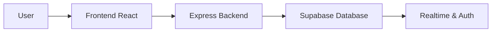
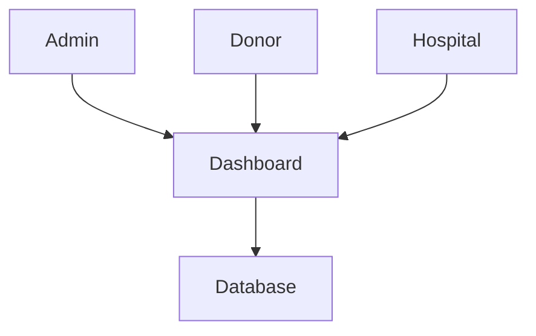
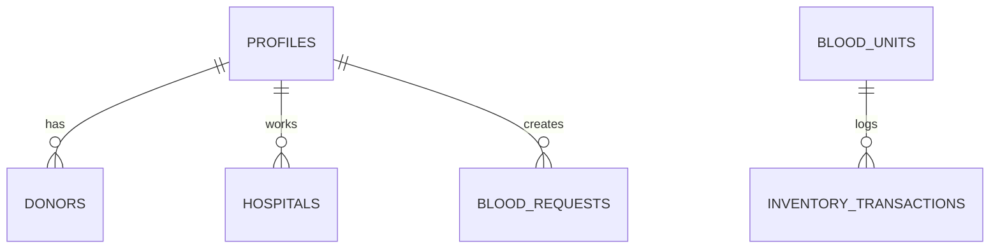
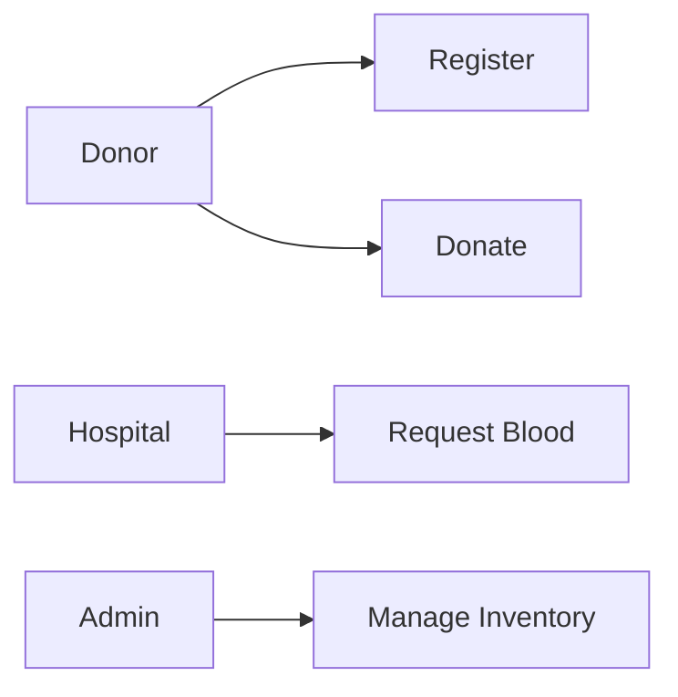

# Blood Bank Management System

## 1. Title Page

Blood Bank Management System (BBMS)  
Department of Computer Science and Engineering  
PMEC Project

## 2. Certificate

This project is submitted in partial fulfillment of the requirement for the degree of ...

## 3. Declaration

I declare that this project is my original work and has not been submitted elsewhere.

## 4. Acknowledgement

We thank our guide and the institution for their guidance.

## 5. Abstract

The Blood Bank Management System is a modern cloud-based application to manage donors, hospitals, blood units, and requests online.

## 6. Introduction

A digital blood bank platform improves coordination and reduces delays in emergencies.

## 7. Problem Statement

Traditional manual blood management is slow, error-prone, and lacks real-time tracking.

## 8. Objectives

- automate donor and hospital tracking
- maintain blood inventory safely
- support emergency blood requests
- provide secure cloud authentication

## 9. Existing System

The current system depends on manual records and phone-based coordination.

## 10. Proposed System

A cloud-based system with donor panels, hospital panels, and admin dashboards.

## 11. Scope

The system handles donor registration, inventory control, request management, notification flow, and reporting.

## 12. Feasibility Study

Technical, operational, and financial feasibility are favorable using Vercel Hobby and Supabase free tiers.

## 13. Hardware Requirements

- Modern desktop or laptop
- Internet connection
- Standard browser

## 14. Software Requirements

- Node.js 18+
- React + Vite
- Express.js
- Supabase
- VS Code

## 15. System Architecture

## 16. Data Flow Diagram

## 17. ER Diagram

## 18. Use Case Diagram

## 19. Database Design

The tables include profiles, donors, hospitals, blood_units, donations, blood_requests, notifications, and audit records.

## 20. Module Description

- Public website
- Admin dashboard
- Donor dashboard
- Hospital dashboard
- Inventory handling

## 21. Implementation

The full system was built using modular frontend pages and an Express API backend.

## 22. Testing

Manual testing, form validation checks, and route-level verification were carried out.

## 23. Results

The application is ready for deployment with a working structure and configuration files.

## 24. Advantages

- smooth donor management
- lower delays in medical response
- online access and secure role-based access

## 25. Limitations

- needs real production Supabase credentials
- free-tier service restrictions apply

## 26. Future Enhancements

- mobile app integration
- SMS alerts
- AI-based stock forecasting

## 27. Conclusion

The BBMS project provides a complete digital foundation for managing blood donation and blood request workflows.

## 28. References

- Supabase documentation
- Vercel documentation
- Express documentation
- React documentation
- Vite documentation
